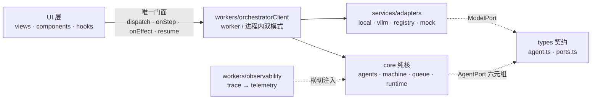

<div align="center">


# YYC³ AI FAMILY · 漫剧工业化指挥中心

**8 拟人化 Agent 协同 · 六阶段流水线 · ReAct-C 九步闭环**


[](https://github.com/YYC-Cube/YYC3-MiniMax/actions/workflows/ci.yml)


</div>

> **_YanYuCloudCube_**
> _言启象限 | 语枢未来_
> **_Words Initiate Quadrants, Language Serves as Core for Future_**
> _万象归元于云枢 | 深栈智启新纪元_
> **_All things converge in cloud pivot; Deep stacks ignite a new era of intelligence_**

---

## 📡 仓库信息

| 项　　　　　　　　　　　　| 值　　　　　　　　　　　　　　　　　　　　　　　　 |
| ---------------------------| ----------------------------------------------------|
| **GitHub 主仓**　　　　　 | <https://github.com/YYC-Cube/YYC3-MiniMax>　　　　 |
| **线上地址（Pages）**　　 | <https://minimax.yyc3.top>（自定义域，HTTPS 强制） |

---

## 🧭 项目概述

「**_YanYuCloudCube_**」言启象限 | 语枢未来

本仓库是 **YYC³ AI FAMILY 漫剧工业化指挥中心** 的全功能前端指挥台（原型演示态，数据层为高保真模拟）。
围绕 **8 位拟人化 AI Agent 家族**，以指挥舱（Command Center）形态完整呈现工业化漫剧生产全链路：

- **六阶段流水线**：小说立项 → 剧本分镜 → 图像生成 → 视频合成 → 成片交付 → 运营反哺
- **ReAct-C 九步闭环**：Reasoning + Acting + Calibration，Step 7 质量门禁不达标自动红色回环（≤2 轮）；已落地为纯函数状态机驱动的真实编排闭环（UI 只发命令、worker 执行、事件回流）
- **六边形编排架构**：8 Agent 统一六元组端口（input/context/tools/output/trace/error），模型经 ModelPort 适配器可替换（local/vLLM/Registry/mock，env 驱动），全链 traceId 留痕，失败可重试/回滚/人工接管
- **双硬门禁**：人物一致性 ≥ 80%、SyncNet 唇形吻合 ≥ 0.75
- **三重安全防线**：PII 三级脱敏、密钥零入库（AST 静态阻断）、数字盲水印
- **混合算力拓扑**：双 DGX（8×H100 ×2）+ Mac Studio M4 Max + TrueNAS 万兆单一事实源
- **实时事件流**：WebSocket 接驳 + 断线降级模拟（高可用双模）
- **真实走时时钟环**：P1 时分秒三针 1s ticking（真实角度公式/差异化长短配色）+ 中心数字时间与星期
- **PWA 可安装**：manifest + Service Worker（离线开屏/外壳缓存）+ 多端品牌图标，桌面与移动一键安装
- **双语就绪 i18n**：自研轻量核（键一致/插值/复数/嵌套/缺省回退），zh-CN 缺省 + en 全量键镜像，键一致性测试门禁
- **全端覆盖**：桌面指挥舱 + PWA 移动版五视图 + 全平台图标（Android/iOS/Web/macOS/watchOS）

> 「**_Words Initiate Quadrants, Language Serves as Core for the Future_**」
> 「**_All things converge in cloud pivot; Deep stacks ignite a new era of intelligence_**」

---

## 🗺️ 功能矩阵

| 视图　　　 | 名称　　　　　　 | 核心能力　　　　　　　　　　　　　　　　　　　　　　　　　　　　　　　　　　　　　　　　　　　　 |
| ------------| ------------------| --------------------------------------------------------------------------------------------------|
| **P1**　　 | 时钟环中心　　　 | 8 Agent 时钟位分布、真实走时三针（时/分/秒差异化长短配色）、数字时间与星期、全息连线、悬浮档案卡 |
| **P2**　　 | 漫剧生产台　　　 | 六阶段流水线卡片阵列、实时事件流（LIVE/SIM 双模）、产能 KPI 带、12 字段分镜 Schema、门禁失败模拟 |
| **P3**　　 | ReAct-C 编排　　 | 九步闭环环形视图（ResizeObserver 全视口自适应）、Step7→Step5 回环演示、Token/耗时遥测、自动轮播　|
| **P4**　　 | 算力监控台　　　 | 4 节点拓扑（DGX×2/Mac/NAS）、GPU/显存/RoCE/NAS 四象限遥测、告警事件队列　　　　　　　　　　　　　|
| **P5**　　 | 质检与安全　　　 | 四大门禁状态灯、分镜质检队列（通过/打回）、PII 脱敏前后对比、宗师终审报告　　　　　　　　　　　　|
| **W1**　　 | Universal Widget | 全局 AI 浮窗（响应式）、8 Agent 秒切、指令语义路由、引用卡跨页跳转、统一品牌标识　　　　　　　　 |
| **Mobile** | PWA 移动版　　　 | < 768px 自动切换：家族/流水线/ReAct/算力/质安五视图实时数据，可安装、离线开屏、安全区适配　　　　|

### AI Family 家族档案

| Agent | 定位 | 驱动模型（示例） | 时钟位 |
| ----- | ---- | ---------------- | ------ |
| 元启·天枢 | 天枢总调度 / 全局决策 | nemotron-super-120b | 12:00 |
| 智云·守护 | 安全合规 / 审计脱敏 | deepseek-v4-guard | 01:30 |
| 格物·宗师 | 质量校验 / 门禁审查 | qwen-2.5-max-eval | 03:00 |
| 创想·灵韵 | 视觉概念 / 艺术生成 | flux-pro-cinema | 04:30 |
| 言启·千行 | 意图识别 / 需求路由 | deepseek-v4-pro | 06:00 |
| 语枢·万物 | 分镜 Schema / 视频合成 | claude-3.7-sonnet | 07:30 |
| 预见·先知 | 趋势预测 / SyncNet 监测 | nemotron-4-340b | 09:00 |
| 知遇·伯乐 | 画像推荐 / 运营反哺 | deepseek-v4-recommender | 10:30 |

---

## 🏗️ 技术架构

| 层级 | 技术 | 说明 |
| ---- | ---- | ---- |
| 框架 | **Next.js 16 App Router** + React 19 + TypeScript 5.7（strict） | 静态导出 SSG（`output: 'export'`），五路由目录形态 |
| 构建 | next build（Turbopack）→ `out/` | 五路由 + 404.html 静态导出，构建约 1s |
| 样式 | Tailwind CSS v4（`@tailwindcss/postcss`） | 原子类 + CSS 变量霓虹主题（无 tailwind.config） |
| 图标 | lucide-react + yyc3-icons 全端图标集 | 品牌单一真源 `public/yyc3-icons/brand/`（favicon/apple-touch/maskable） |
| 可视化 | 原生 SVG | 时钟环 / 九步环 / 遥测曲线 / 环形仪表，零图表库 |
| PWA | Web App Manifest + Service Worker v2 | 可安装/五路由预缓存/离线开屏/快捷方式直达路由，见 `public/sw.js` |
| 实时流 | 原生 WebSocket + 指数退避重连 | `src/services/eventStream.ts`，无后端自动降级模拟 |
| 编排 | 六边形架构（core 纯核 + workers 桥 + ports 契约 + adapters 适配器） | 8 Agent 六元组端口、ReAct-C 状态机、P0>P1>P2 队列、traceId 全链留痕、人工接管三键 |
| 元信息 | Metadata / Viewport API | layout.tsx 声明式 head（12 项），robots index 已启用 |
| 测试 | Vitest 5 + happy-dom + Testing Library | 数据/服务/组件/契约/编排/图标/i18n 七类单测（445 例 / 33 文件） |
| 质量 | tsc + eslint + knip + madge + dependency-cruiser + vitest 覆盖率 + bundle 预算 + gitleaks + Lighthouse | CI 全门禁（0 error；覆盖率棘轮 lines 96/branches 87/functions 93/statements 94，仅升不降） |

### 工程原则（五高五标五化落地）

- **五高**：高可用（事件流断线降级、门禁熔断回环）· 高性能（200ms 级视图切换）· 高安全（P5 三级脱敏演示）· 高可扩展（视图/服务/数据三层解耦）· 高智能（W1 指令语义路由）
- **五标**：标准化（12 字段 Schema）· 规范化（P1-P5 视图命名）· 自动化（CI 门禁/自动轮播）· 可视化（全链路遥测）· 智能化（Agent 家族协同）
- **五化**：流程化（六阶段闭环）· 数字化（KPI 带）· 生态化（多模型编排）· 工具化（指挥台）· 服务化（事件流服务层模块化）

---

## 🚀 快速开始

### 环境要求

- Node.js ≥ 22（推荐 [mise](https://mise.jdx.dev/)，仓库已含 `.mise.toml`）
- pnpm ≥ 10（项目 `.npmrc` 已固定项目内 store）

### 安装与运行

```bash
# 1. 安装依赖（.npmrc 已将 store 指向项目内，受限沙箱亦可运行）
pnpm install

# 2. 启动开发服务器（next dev，默认端口 3000，团队规范自 3030 起顺延）
PORT=3032 pnpm dev

# 3. 生产构建（静态导出至 out/）+ 预览
pnpm build
pnpm preview

# 4. 质量门禁（本地全量）
pnpm typecheck        # tsc --noEmit
pnpm lint             # eslint .
pnpm knip             # 死代码/未用导出
pnpm madge:circular   # 循环依赖
pnpm depcruise        # 分层边界（六边形契约）
pnpm test:coverage    # vitest + 覆盖率棘轮
pnpm build && pnpm budget   # 静态导出 + 包体积预算
pnpm test             # vitest run（单次）
pnpm test:watch       # vitest watch 模式
pnpm format           # oxfmt 格式化
```

> 预览地址：<http://localhost:3032/>（以终端实际输出为准）

### 脚本一览

| 命令 | 说明 |
| ---- | ---- |
| `pnpm dev` | 启动 next dev 开发服务器（读取 `PORT` 环境变量，默认 3000） |
| `pnpm build` | 生产构建 + 静态导出（输出至 `out/`，trailingSlash 目录形态） |
| `pnpm preview` | 本地预览 `out/` 静态产物 |
| `pnpm typecheck` | TypeScript 类型门禁（0 error 标准） |
| `pnpm test` / `pnpm test:watch` | Vitest 单测（单次 / 监听） |
| `pnpm test:icons` | 图标链路专项（5 平台 44 枚尺寸矩阵 + manifest 对齐，7 例） |
| `pnpm test:i18n` | i18n 专项（键一致/切换无残留/插值/复数/嵌套/回退/日期本地化，13 例） |
| `pnpm test:coverage` | 单测 + v8 覆盖率（棘轮 lines 96 / branches 87 / functions 93 / statements 94） |
| `pnpm lint` | ESLint 门禁（typescript-eslint + next/core-web-vitals，0 error 标准） |
| `pnpm knip` | 依赖/导出死代码检测 |
| `pnpm madge:circular` | 循环依赖检测（全 src，0 容忍） |
| `pnpm depcruise` | dependency-cruiser 分层边界守卫（core 纯核/UI 门面唯一/workers 禁 UI） |
| `pnpm budget` | 构建产物包体积预算门禁（总量 ≤850KB，单 chunk ≤280KB） |
| `pnpm audit:lighthouse` | Lighthouse CI 运行时预算（LCP/CLS/TBT/性能分，需先 build） |
| `pnpm format` | oxfmt 格式化 |

### 实时事件流接驳（WebSocket）

P2 事件流内置高可用双模客户端 [src/services/eventStream.ts](./src/services/eventStream.ts)：

```bash
# .env.local（可选）配置真实网关后自动切换 LIVE 模式
NEXT_PUBLIC_EVENT_STREAM_URL=wss://gateway.yyc3.local/agent-events
```

- **LIVE 模式**：连接 WebSocket 实时流，断线指数退避重连（≤ 5 次，上限 30s）
- **SIM 模式**：未配置或连接失败时自动降级为内置模拟流，链路永不中断
- **消息协议**：`{ "agentId": "tianshu", "message": "...", "level": "INFO", "tag": "ROUTE" }`
  （兼容 `{ "type": "log", "data": {...} }` 包装；非法消息静默丢弃）
- P2 事件流头部状态灯实时显示当前模式（`LIVE · WebSocket` / `SIM · 模拟流`）

### 编排接驳（模型提供方切换）

ReAct-C 编排已解耦为六边形架构：UI 经唯一门面 [src/workers/orchestratorClient.ts](./src/workers/orchestratorClient.ts)
dispatch / onStep / onEffect / resume；模型推理经 ModelPort 适配器 env 驱动装配
（[src/services/adapters/index.ts](./src/services/adapters/index.ts)，配置不全自动降级 mock 并结构化告警）：

```bash
# .env.local（可选）接驳真实推理后端（缺省 mock 演示态）
NEXT_PUBLIC_MODEL_PROVIDER=local        # local | vllm | registry | mock
NEXT_PUBLIC_MODEL_LOCAL_URL=http://127.0.0.1:11434    # provider=local 时
NEXT_PUBLIC_MODEL_VLLM_URL=http://127.0.0.1:8000/v1   # provider=vllm 时
NEXT_PUBLIC_MODEL_REGISTRY_URL=https://registry.yyc3.local  # provider=registry 时
```

- **worker 模式**：编排跑在真实 DedicatedWorker 线程（UI 主线程零阻塞）；不可用时自动降级进程内运行，事件语义完全一致
- **全链留痕**：每步 traceId/耗时/Token/模型名/风险标签经 `workers/observability` 落 telemetry（`metric.agent.step.*` / `audit.react.*`）
- **人工接管**：Step7 复检 ≤2 轮耗尽后挂起，W1 推送接管卡片（重跑 Step5 / 回滚检查点 / 终止任务）
- 分层边界由 [.dependency-cruiser.cjs](./.dependency-cruiser.cjs) 物理固化（`pnpm depcruise`，13 条 error 级规则）

编排链路依赖方向（物理 import，depcruise 守卫）：



---

## 📂 目录结构

```
YYC3-MiniMax/
├── public/
│   ├── manifest.webmanifest     # PWA 清单（图标/快捷方式/standalone）
│   ├── sw.js                    # Service Worker（外壳缓存/离线回退/SWR）
│   ├── yyc3-family.png          # 文档顶图 / 品牌全家福
│   └── yyc3-icons/
│       ├── brand/               # 品牌图标套件（favicon/192/512/maskable/apple-touch）
│       └── Android/iOS/Web App/macOS/watchOS/  # 全员全端图标源
├── src/
│   ├── app/                     # Next.js App Router（静态导出约定层）
│   │   ├── layout.tsx           # 根布局：Metadata/Viewport API + 全局壳挂载
│   │   ├── page.tsx             # 根路由 P1；p2/-p5/ 五路由同构薄壳
│   │   ├── CommandCenterContext.tsx # 跨路由共享状态 + 编程式路由
│   │   ├── CommandShell.tsx     # 全局壳（Header/Footer/W1/缩放/移动分支）
│   │   ├── LegacyViewBridge.tsx # ?view= 旧深链 → 真路由桥接
│   │   ├── Bootstrap.tsx        # 错误钩子 + SW 注册
│   │   ├── error.tsx / global-error.tsx / not-found.tsx
│   │   └── globals.css          # Tailwind v4 入口 + 霓虹主题 + keyframes
│   ├── components/
│   │   ├── Header.tsx           # 顶部导航（Link 路由化）+ 实时时钟 + PWA 安装
│   │   ├── Footer.tsx           # 底部状态栏（NAS/任务队列/在线率/路由 CTA）
│   │   ├── AgentAvatar.tsx      # Agent 头像（光环/脉冲环/状态 LED）
│   │   ├── BrandMark.tsx        # 品牌标识单一真源（全局 logo 统一引用）
│   │   ├── PwaInstallButton.tsx # PWA 安装按钮（beforeinstallprompt）
│   │   ├── UniversalWidget.tsx  # W1 全局 AI 浮窗（跨路由唯一实例）
│   │   └── widget/TakeoverCard.tsx # 人工接管卡片（rerun/rollback/abort 三键）
│   ├── core/                    # 编排纯核（零 UI/零框架，depcruise 守卫）
│   │   ├── agents/index.ts      # 8 Agent 行为核（六元组端口统一装配）
│   │   ├── machine/reactStateMachine.ts # ReAct-C 九步纯函数状态机（S7→S5 回环）
│   │   ├── queue/taskQueue.ts   # P0>P1>P2 优先级任务队列
│   │   └── runtime/orchestrator.ts # 编排运行时（串行泵/会话检查点/指数退避/resume）
│   ├── workers/                 # 桥接层（core ↔ UI）
│   │   ├── orchestratorClient.ts    # UI 唯一门面（worker/进程内双模式单例）
│   │   ├── orchestratorWorker.ts    # 消息协议桥（入站守卫/出站回流）
│   │   ├── orchestratorWorker.entry.ts # DedicatedWorker 线程入口
│   │   └── observability.ts        # trace→遥测统一落点（metric/audit）
│   ├── views/
│   │   ├── P1FamilyCenter.tsx   # P1 时钟环中心（真实走时三针）
│   │   ├── P2ProductionDesk.tsx # P2 漫剧生产台
│   │   ├── P3ReActWorkflow.tsx  # P3 ReAct-C 九步编排（live 快照订阅）
│   │   ├── P4OpsMonitoring.tsx  # P4 算力监控台
│   │   ├── P5QualitySecurity.tsx# P5 质检与安全
│   │   └── MobileFallback.tsx   # PWA 移动版五视图（< 768px）
│   ├── services/
│   │   ├── eventStream.ts       # WebSocket 事件流客户端（降级模拟/重连/规范化）
│   │   ├── adapters/            # ModelPort 适配器（http/mock/local/vllm/registry，env 装配）
│   │   ├── telemetry.ts         # 遥测事件总线（sink/结构化事件）
│   │   └── pwa.ts               # Service Worker 注册（仅生产环境）
│   ├── hooks/
│   │   ├── useMediaQuery.ts     # 响应式媒体查询 Hook
│   │   ├── usePwaInstall.ts     # PWA 安装能力 Hook
│   │   ├── useWidgetChat.ts     # W1 会话（dispatch + 事件回流）
│   │   └── useReActSnapshot.ts  # ReAct 实时快照（P3 live 徽标/回环/接管态）
│   ├── data/                    # 高保真模拟数据层（单一事实源）
│   │   ├── agents.ts            # 8 Agent 档案
│   │   ├── pipeline.ts          # 六阶段 + KPI + 12 字段 Schema
│   │   ├── reactSteps.ts        # ReAct-C 九步定义
│   │   └── logs.ts / opsData.ts / qualityData.ts
│   ├── types/
│   │   ├── index.ts             # 全局类型定义（Agent/流水线/日志/遥测）
│   │   ├── agent.ts             # AgentPort 六元组契约 + 运行时守卫
│   │   └── ports.ts             # ModelPort/OrchestratorPort/TaskQueuePort 端口契约
│   └── env.d.ts                 # NEXT_PUBLIC_* 环境变量类型契约
├── tests/                       # Vitest 单测（数据/服务/组件/契约/编排/PWA）
├── scripts/bundle-budget.mjs    # 包体积预算门禁脚本
├── next.config.ts               # Next 16 配置（output:'export'/trailingSlash/images）
├── postcss.config.mjs           # Tailwind v4 PostCSS 插件
├── eslint.config.js             # typescript-eslint + next/core-web-vitals + 纯核禁令
├── .dependency-cruiser.cjs      # 分层边界守卫（13 条 error 级规则）
├── lighthouserc.cjs             # Lighthouse 运行时预算断言
├── .github/workflows/ci.yml     # CI 质量门禁 + GitHub Pages 自动部署
├── docs/                        # 团队规范 + 会话工作文档 + 迁移评估清单
└── package.json
```

---

## 📚 开发者文档导航

| 文档 | 说明 |
| ---- | ---- |
| 📄 [LICENSE](./LICENSE) | MIT 开源许可证 |
| 🤝 [CODE_OF_CONDUCT.md](./CODE_OF_CONDUCT.md) | 行为准则（贡献者公约） |
| 🛠️ [CONTRIBUTING.md](./CONTRIBUTING.md) | 贡献指南与工作流 |
| 🔐 [SECURITY.md](./SECURITY.md) | 安全政策与漏洞上报 |
| 📐 [docs/YYC3-团队通用-标准规范/](./docs/YYC3-团队通用-标准规范/) | 团队五维驱动 / 开发标准 / 文档闭环 |

---

## 🏷️ 仓库标签 / 关键词（Topics）

仓库标签三处同一真源：本文档 YAML 标头 / `package.json` `keywords` / GitHub Topics（已通过 API 写入）。
GitHub Topics 命名规范：全小写、连字符分词、不超过 20 个标签、单个标签 ≤ 50 字符。

| 分类 | 标签 |
| ---- | ---- |
| 技术栈 | `nextjs` · `react` · `typescript` · `tailwindcss` · `vitest` · `pnpm` |
| 形态 | `pwa` · `service-worker` · `spa` · `offline-first` |
| 领域 | `ai-agent` · `multi-agent-orchestration` · `react-c` |
| 场景 | `command-center` · `realtime-dashboard` · `data-visualization` · `svg-animation` |
| 平台/品牌 | `github-pages` · `ai-family` · `yyc3` |

> GitHub 仓库页 → About ⚙ 可查看已配置的 Topics。

---

## 🌐 部署设计（GitHub Pages 全链路闭环）

```
push main / workflow_dispatch ──► 质量门禁（gitleaks/lint/tsc/knip/madge/depcruise/vitest+coverage/build）
              │ 全绿后
              ▼
         deploy-pages 作业
              ├─ 重新生产构建（custom domain ⇒ base: '/'）
              ├─ 产物检测：CNAME / index.html / manifest / sw.js / favicon
              │            存在且非空 + 无 noindex（检测无误后放行）
              ├─ configure-pages（enablement: true，幂等自愈启用）
              ├─ upload-pages-artifact ─► deploy-pages（OIDC，无长期密钥）
              ▼
        https://minimax.yyc3.top（自定义域 · HTTPS 强制）
```

| 设计项 | 配置 | 说明 |
| ------ | ---- | ---- |
| 自定义域 | `public/CNAME` → `minimax.yyc3.top` | 随构建产物进入 `dist/`，GitHub Pages 读取后绑定自定义域 |
| DNS | `CNAME minimax.yyc3.top → YYC-Cube.github.io` | 已在云 DNS 生效（Pages 已识别自定义域） |
| HTTPS | Enforce HTTPS 已开启 | 证书由 GitHub 自动签发续期 |
| 构建模式 | `build_type: workflow` | Pages 数据源为 Actions 工作流，非分支推送 |
| 触发条件 | `push main` / 手动 `workflow_dispatch`，且质量门禁全绿 | PR 只跑门禁不部署；手动触发仅验证门禁，防未审产物上线 |
| 部署互斥 | `concurrency: ci-{ref}` | 新推送自动取消在途部署，避免竞态覆盖 |
| 鉴权 | OIDC + `pages:write` / `id-token:write` | 零长期密钥，token 权限最小化 |

> SPA 注意事项：本站为纯前端 SPA（无客户端路由子路径），无需 404 回退；如未来引入路由，需追加 404.html 重定向方案。

---

## 🗓️ 路线图 Roadmap

- [x] P1-P5 五大视图 + W1 全局浮窗原型闭环
- [x] ReAct-C 九步闭环可视化（含 Step7 回环模拟）
- [x] WebSocket 事件流客户端接驳（断线重连 + 无后端自动降级模拟流）
- [x] vitest 单测 + GitHub Actions CI 质量门禁（tsc/test/build 三段）
- [x] PWA 移动版（< 768px 自动切换五视图实时数据、可安装、离线开屏、安全区适配）
- [x] 全端图标与品牌单一真源（yyc3-icons + brand/ 套件：favicon/apple-touch/maskable）
- [x] P1 真实走时时钟（时分秒三针）+ P3 九步环全视口自适应
- [x] GitHub 仓库化 + Pages 自动部署闭环（质量门禁 → 产物检测 → minimax.yyc3.top）
- [ ] W1 接入真实 LLM 网关（多模型路由）
- [ ] P4 接入 Prometheus / node_exporter 真实遥测
- [x] Agent 编排内核落地（core 纯核端口适配器 + 九步状态机 + worker 双模式，PR1-PR7 已交付）

---

## 🌍 项目概述（英文摘要）

> An immersive command center that streamlines the industrial production of
> comics and short films, enabling real-time collaboration among eight
> anthropomorphic AI agents — six-stage pipeline, ReAct-C nine-step closed
> loop, dual hard quality gates (consistency ≥ 80%, SyncNet ≥ 0.75),
> three-tier PII masking, resilient WebSocket event streaming, a real-ticking
> analog clock ring and an installable PWA with offline shell (mobile-first
> responsive views).

---

## 📜 变更历史

| 版本 | 日期 | 变更内容 | 作者 |
| ------ | ---------- | ---------------------------------------------------------------- | ------------------- |
| v1.2.2 | 2026-10-16 | 文档可视化体系升级：徽章两行分组重构与版本对齐（TS 5.7）、12 章节图标体系、开发者文档导航图标、编排 mermaid 依赖图；CI 加固（最小权限基线/timeout 预算/workflow_dispatch）；事实修正（13 条 depcruise 规则/路线图编排内核勾选） | YanYuCloudCube Team |
| v1.2.1 | 2026-10-15 | GitHub 仓库化：主仓地址/Topics 标签体系（20 项）/Pages 自动部署 CI（产物检测+OIDC+CNAME）/robots 收录修正 | YanYuCloudCube Team |
| v1.2.0 | 2026-10-12 | P1 真实三针时钟；P3 全视口自适应；PWA（manifest/SW/安装）落地；品牌图标单一真源；README YAML 标头修复与标签体系 | YanYuCloudCube Team |
| v1.1.0 | 2026-10-11 | 新增 WS 事件流/vitest+CI/移动端降级/全端图标；合规标头标尾 | YanYuCloudCube Team |
| v1.0.0 | 2026-10-11 | 初始版本：五视图原型交付、审计修复、开发者文档五件套 | YanYuCloudCube Team |

---

<div align="center">

**© 2025-2026 YanYuCloudCube Team. All Rights Reserved.**

「**_YanYuCloudCube_**」言启象限 | 语枢未来
「**_Words Initiate Quadrants, Language Serves as Core for the Future_**」
「**_All things converge in cloud pivot; Deep stacks ignite a new era of intelligence_**」

<admin@0379.email>

</div>
