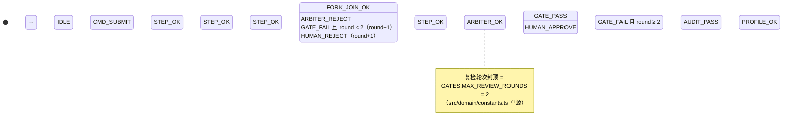
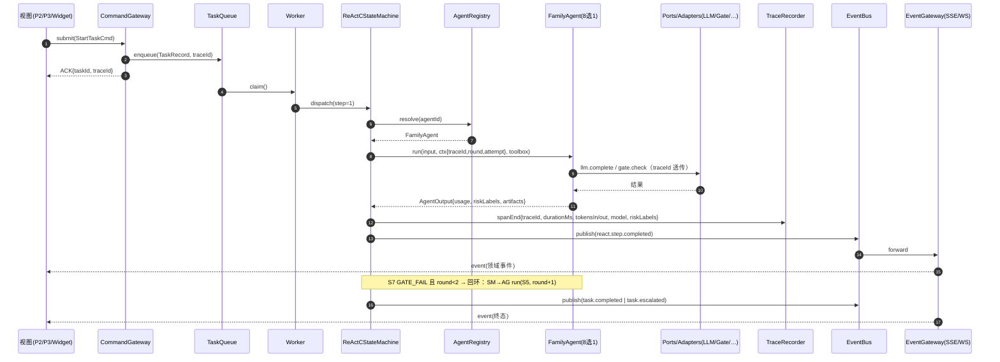

# 🏗️ AI Family 8 Agent × ReAct-C 九步闭环 架构解耦设计

## 0. 现状诊断（基于代码勘察，非臆测）

| # | 现状 | 代码位置 | 解耦问题 |
|---|------|----------|----------|
| 1 | 九步闭环是静态展示数据 | `src/data/reactSteps.ts` | status/tokens/durationMs 硬编码，无真实状态机与回环 |
| 2 | UI 直调 mock NLU | `src/components/UniversalWidget.tsx:30` → `services/agentReply.ts` | Agent 逻辑与 UI 文案耦合，无法换真实 LLM |
| 3 | 事件流直连 `WebSocket` 全局 | `src/services/eventStream.ts:142` | 传输协议不可替换，无领域事件总线 |
| 4 | `fetch` 散落在 service | `src/services/piiReveal.ts:63` | 无统一 HTTP port，无超时/重试/留痕 |
| 5 | `localStorage` 在 hook 层裸用 | `src/hooks/useLocalStorage.ts:27,40` | 仅限 UI 持久化，core 层必须封禁 |
| 6 | 无编排运行时 | — | 无任务队列、无 worker、无重试/回滚/人工接管 |
| 7 | telemetry 已零依赖 ✅ | `src/services/telemetry.ts` | 可直接平移为 core 基础设施 |
| 8 | 门禁常量已单源 ✅ | `src/domain/constants.ts`（`MAX_REVIEW_ROUNDS: 2`） | 状态机回环上限直接引用 |

**结论**：现有代码是「展示型数字孪生」，缺一个与 UI 彻底解耦的编排内核。本设计给出内核形态与 7 步 PR 落地路径。

---

## 1. 目标分层架构

```
┌──────────────────────────────────────────────────────────────────┐
│ L4 UI 层（React 19 + Vite，可整体替换/可删除）                     │
│   职责仅两项：submit(command) + 订阅(events)                       │
│   禁止：import core 内部实现、直调 Agent、持有业务流转状态           │
├──────────────────────────────────────────────────────────────────┤
│ L3 Gateway（命令/事件边界；进程内实现，未来可平替为 HTTP+SSE）       │
│   CommandGateway · EventGateway · HumanGate                      │
├──────────────────────────────────────────────────────────────────┤
│ L2 agent-orchestrator（纯 TS，零 React / 零 Next.js / 零 DOM 依赖）│
│   TaskQueue → Worker → ReActCStateMachine → AgentRegistry        │
│   TraceRecorder · RollbackJournal · RetryPolicy                  │
│   ※ 元启·天枢是 Agent（S6 仲裁者），编排器是 Runtime——决策在       │
│     Agent，流转在状态机，二者不可混同                              │
├──────────────────────────────────────────────────────────────────┤
│ L1 Ports（能力契约）+ Adapters（可替换实现）                       │
│   LLMPort: sim │ ollama-local │ vllm-openai │ yyc3-registry      │
│   VectorPort / ImagePort / VideoPort / QualityGatePort /         │
│   AuditPort / ProfilePort / HttpPort / TaskJournalPort           │
└──────────────────────────────────────────────────────────────────┘
```

依赖方向：L4 → L3 → L2 → L1，**严禁反向**（由 ESLint + 架构测试双封锁，见 §7）。

---

## 2. 交付物一：Agent 端口接口定义（六字段统一契约）

```typescript
// src/core/ports/agent.types.ts —— 8 Agent 统一契约：input/context/tools/output/trace/error

export type AgentId =
  | 'tianshu' | 'shouhu' | 'zongshi' | 'lingyun'
  | 'qianxing' | 'wanwu' | 'xianzhi' | 'bole';

export type RiskLabel = 'pii' | 'copyright' | 'safety' | 'cost' | 'quality' | 'none';

/** ① input */
export interface AgentInput<P = unknown> {
  readonly kind: string;            // 步骤语义类型，如 'storyboard.draft' / 'gate.check'
  readonly payload: P;
}

/** ② context —— 运行时注入，Agent 不得自取 */
export interface AgentContext {
  readonly taskId: string;
  readonly traceId: string;         // 全链路贯穿
  readonly spanId: string;          // 单步跨度
  readonly step: 1 | 2 | 3 | 4 | 5 | 6 | 7 | 8 | 9;
  readonly round: number;           // 复检轮次（S7→S5 回环计数，≤ GATES.MAX_REVIEW_ROUNDS）
  readonly attempt: number;         // 同步重试次数
  readonly upstream: Readonly<Record<string, AgentArtifact>>; // 上游产物（只读视图）
  readonly budget: { readonly maxTokens: number; readonly deadlineMs: number };
}

/** ③ tools —— 能力经 port 注入；Agent 拿不到 fetch/DOM/localStorage */
export interface AgentToolbox {
  readonly llm: LLMPort;
  readonly vector: VectorPort;
  readonly image: ImagePort;
  readonly video: VideoPort;
  readonly gate: QualityGatePort;
  readonly audit: AuditPort;
}

/** ④ output */
export interface AgentOutput<P = unknown> {
  readonly payload: P;
  readonly confidence: number;                       // 0~1
  readonly artifacts: readonly AgentArtifact[];      // 产物登记（回滚依据）
  readonly riskLabels: readonly RiskLabel[];         // 风险标签（留痕字段）
  readonly usage: {                                  // 留痕字段：模型名/Token
    readonly model: string;
    readonly tokensIn: number;
    readonly tokensOut: number;
    readonly durationMs: number;
  };
}

/** ⑥ error —— 结构化，驱动重试/回滚/接管三分支 */
export interface AgentError {
  readonly code: string;              // 如 'LLM_TIMEOUT' / 'GATE_FAIL' / 'PII_DETECTED'
  readonly retryable: boolean;        // true → RetryPolicy 同步重试
  readonly rollbackHint?: string;     // 回滚补偿提示
  readonly humanTakeoverRequired: boolean;
  readonly cause?: unknown;
}

export type AgentResult<P> =
  | { readonly ok: true; readonly output: AgentOutput<P> }
  | { readonly ok: false; readonly error: AgentError };

/** Agent 本体：仅暴露 run + rollback，无其他权威 */
export interface FamilyAgent<PIn = unknown, POut = unknown> {
  readonly id: AgentId;
  readonly supportedSteps: ReadonlyArray<AgentContext['step']>;
  run(input: AgentInput<PIn>, ctx: AgentContext, tools: AgentToolbox): Promise<AgentResult<POut>>;
  rollback(ctx: AgentContext, tools: AgentToolbox): Promise<void>;   // 逆序补偿钩子
}
```

能力 Port 示例（适配器可替换：本地模型 / vLLM / Registry / sim）：

```typescript
export interface LLMPort {
  complete(req: {
    messages: readonly { role: 'system' | 'user' | 'assistant'; content: string }[];
    model?: string;                // 缺省用 Agent 档案 model，适配器可覆盖
    maxTokens: number;
    temperature: number;
    traceId: string;
    signal?: AbortSignal;
  }): Promise<{ text: string; model: string; tokensIn: number; tokensOut: number }>;
}
// adapters/llm/: SimLlmAdapter（现有 agentReply 降级于此）
//              OllamaLocalAdapter / VllmOpenAiAdapter / Yyc3RegistryAdapter
```

8 Agent ↔ Port 责任矩阵：

| Agent | id | 承载步骤 | 主用 Port | 适配器示例 |
|---|---|---|---|---|
| 智云·守护 | shouhu | S1 入安检 / S8 出审计 | AuditPort + LLMPort | deepseek-guard 规则引擎 / vLLM |
| 言启·千行 | qianxing | S2 意图路由 / S3 RAG | LLMPort + VectorPort | Milvus adapter / 本地向量 |
| 语枢·万物 | wanwu | S4 分镜 Schema / S4′ 视频 | LLMPort + VideoPort | claude / vLLM / 本地 |
| 预见·先知 | xianzhi | S4″ 预测（与 wanwu 并行） | LLMPort + HttpPort（SyncNet 指标） | 指标服务 / sim |
| 创想·灵韵 | lingyun | S5 报告润色 | LLMPort + ImagePort | flux / 本地扩散 |
| 元启·天枢 | tianshu | S6 全局仲裁 | LLMPort（结构化决策输出） | nemotron / vLLM |
| 格物·宗师 | zongshi | S7 质量复检 | QualityGatePort | 阈值引擎 / 多模态评测 |
| 知遇·伯乐 | bole | S9 画像反哺 | ProfilePort | 画像库 / sim |

---

## 3. 交付物二：九步状态机

S4 内部为 fork-join（wanwu ‖ xianzhi 并发，join 后进 S5）；S7 门禁失败回环 S5，`round ≤ GATES.MAX_REVIEW_ROUNDS(2)`，超限转人工。



**横向不变式（对所有步骤 Si 生效）**：

| 事件 | 守卫 | 迁移 |
|---|---|---|
| `STEP_ERR(retryable)` | attempt < 3 | Si → Si（指数退避，attempt+1） |
| `STEP_ERR(retryable)` | attempt ≥ 3 | Si → ROLLING_BACK → FAILED |
| `STEP_ERR(fatal)` | — | Si → ROLLING_BACK → FAILED |
| `CMD_CANCEL` | 任意运行态 | Si → ROLLING_BACK → CANCELLED |
| `HUMAN_TAKEOVER` | 任意运行态 | Si → WAITING_HUMAN → 人工 resume |

实现为**纯 reducer**（`core/react-c/machine.ts`）：`(state, event) → state`，无副作用、可回放；副作用只由 Worker 在状态迁出时执行。回环正确性用属性测试锁死：随机失败注入下「S7 回环次数 ≤ 2」恒成立。

终态集合：`COMPLETED | FAILED | CANCELLED`；受控暂停态：`WAITING_HUMAN`。

---

## 4. 交付物三：任务队列与 Agent 交互时序

UI 只发命令、worker 执行、事件回流——UI 与 Agent 之间**零直接调用**。



关键设计点：

- **命令**（`StartTaskCmd / CancelCmd / HumanDecisionCmd / RetryCmd`）单向流入；**事件**（`react.step.* / task.* / trace.span`）单向回流，二者均经 Gateway，UI 可整体替换为 CLI 而内核无感。
- TaskQueue 先做**进程内 Memory 实现**（有界 + 背压），预留 `TaskJournalPort`（Redis/SQLite 适配器位）满足高可用。
- 幂等：`taskId + step + round + attempt` 四元组作为幂等键，重试不重复计费不重复产 artifacts。

---

## 5. 交付物四：模块抽离与 PR 拆分

目标目录（单仓渐进，后续可平移 pnpm workspace 包 `@yyc3/agent-orchestrator`）：

```
src/
├── core/                    ← L2+L1，禁 react/DOM/localStorage/fetch/WebSocket
│   ├── domain/              AgentId、TaskRecord、DomainEvent、GATES 引用
│   ├── ports/               agent.types.ts + 8 个能力 port
│   ├── react-c/             steps.ts(定义) + machine.ts(纯 reducer) + guards.ts
│   ├── queue/               taskQueue.ts(Memory) + journal port
│   ├── runtime/             worker.ts + registry.ts + retry.ts + rollback.ts + humanGate.ts
│   ├── observability/       trace.ts(telemetry 平移) + traceRecorder.ts
│   ├── agents/              8 个 FamilyAgent 实现（每 Agent 一目录）
│   └── adapters/            llm/ vector/ image/ gate/ …（sim 先行）
├── gateway/                 commandGateway.ts + eventGateway.ts + humanGateApi.ts
├── ui-adapters/             eventStreamTransport(WS) / localStorage 持久化 / piiReveal HTTP
└── views|hooks|components/  保持不动，仅改数据来源
```

| PR | 内容 | 验收门禁 |
|---|---|---|
| **PR-1** 骨架与封禁 | `core/` 目录 + domain 类型 + ESLint `no-restricted-globals/imports`（对 `src/core/**`）+ 架构测试 | `pnpm typecheck/lint/test/madge:circular` 全绿；core 引 react/fetch/localStorage 即 CI 红 |
| **PR-2** 可观测平移 | `telemetry.ts → core/observability/trace.ts`；新增 TraceRecorder（span: traceId/durationMs/tokens/model/riskLabels）；UI sink 适配 | 既有 `tests/telemetry.test.ts` 迁移通过 |
| **PR-3** 状态机 | `reactSteps.ts` 拆 steps.ts + machine.ts 纯 reducer；S7→S5 回环守卫；属性测试（失败注入下回环≤2） | P3 视图改读 machine 快照（sim driver），视觉无回归 |
| **PR-4** 队列与网关 | TaskQueue + Worker + CommandGateway + EventBus；UniversalWidget 改 `submit(IntentCommand)`；`agentReply.ts` 降级为 SimLlmAdapter | `app-orchestration.test.tsx` 改造后通过；UI 无 core 内部 import |
| **PR-5** Ports+Adapters | 8 port 契约 + sim/vllm/ollama/registry 四 LLMPort 适配器（后三先空实现+契约测试）；8 Agent 落位 `core/agents/` | 每适配器契约测试通过；换适配器不改内核一行 |
| **PR-6** 韧性三件套 | RetryPolicy(指数退避≤3) + RollbackJournal(逆序补偿) + HumanGate(WAITING_HUMAN/接管/resume) + TaskJournalPort | 故障注入测试：可重试/可回滚/可接管三分支全覆盖 |
| **PR-7** UI 收口 | views 全走 gateway；`useLocalStorage` 仅存于 ui-adapters；`piiReveal` fetch 移入 HttpPort adapter；删除直连残留 | `knip` 零死代码；`contract-consistency.test.tsx` 通过 |

每个 PR 独立可合并、可回退，门禁统一：`typecheck + lint + test + madge:circular + knip`。

---

## 6. 留痕与韧性需求映射（需求 → 机制）

| 需求 | 机制 |
|---|---|
| traceId/耗时/Token/模型名/风险标签 全留痕 | TraceRecorder span 五字段强制（TS 类型必填），经 EventBus 广播，UI 仅展示 |
| 失败可重试 | `AgentError.retryable` → RetryPolicy（attempt≤3，指数退避，幂等键防重放） |
| 可回滚 | AgentOutput.artifacts 登记制 → RollbackJournal 逆序调 `agent.rollback` + adapter 补偿 |
| 可人工接管 | WAITING_HUMAN 态 + HumanGate；UI 接管按钮仅发 `HumanDecisionCmd` |

---

## 7. 交付物五：三条禁令（约定 → 机器强制）

> 禁止 Agent 直接操作 DOM、直接读 localStorage、直接 fetch——不靠自觉，靠四层封锁：

1. **ESLint**（`eslint.config.js` 对 `src/core/**` override）：
   - `no-restricted-globals`: `document / window / localStorage / fetch / WebSocket / XMLHttpRequest`
   - `no-restricted-imports`: `react / react-dom / next/* / src/{views,components,hooks,ui-adapters}/**`
2. **测试环境隔离**：`core/**` 的 vitest 用例跑 `node` 环境（非 happy-dom）——DOM/localStorage 泄漏直接炸测试。
3. **架构测试**：`tests/architecture.test.ts` 静态扫描 core 全部 import，断言禁令模式，挂进 `.github/workflows/ci.yml`。
4. **能力注入**：Agent 函数签名只收 `AgentToolbox`（port 句柄），无其他权威来源——Agent 想作恶都没有工具。

---

## 8. 五高对标

| 五高 | 落点 |
|---|---|
| 高可用 | LIVE/SIM 双模降级沿袭 eventStream 设计；TaskJournal 持久化恢复；遥测故障不阻断业务 |
| 高性能 | S4 fork-join 并行；进程内有界队列背压；reducer 纯函数零锁 |
| 高安全 | Agent 能力注入 + 风险标签全留痕 + S1/S8 双端安检 + PII 走 AuditPort |
| 高可扩展 | 全部能力走 port，适配器替换零内核改动；队列/网关均可外置化 |
| 高智能 | 仲裁/复检/回环全部结构化决策输出，为后续策略模型化预留 |

---

**审核结论**: 设计就绪，可按 PR-1 起步
**下次衔接点**: PR-1（core 骨架 + ESLint 封禁 + 架构测试）
