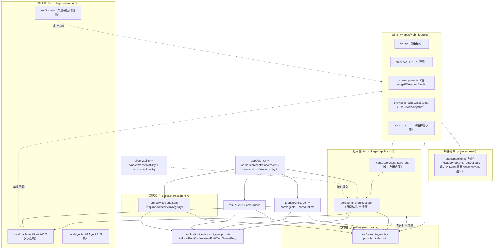

# 🗺 目标架构可视化与依赖规则核验

> 目标：以「六边形 + 单仓分层」目标架构图为镜，映射到本仓实际物理结构，
> 逐条核验依赖方向规则；缺口处以 dependency-cruiser 规则物理固化。

## 一、目标架构 → 本仓物理映射

## 二、依赖方向规则逐条核验

| # | 目标规则 | 判定 | 证据（规则/命令/文件行号） |
| --- | ---------- | ------ | --------------------------- |
| 1 | UI → application → domain | ✅ | UI 层对 workers 仅 2 处直连且均为门面：[useWidgetChat.ts#L30](file:///Users/yanyu/YYC-Cube/YYC3-MiniMax/src/hooks/useWidgetChat.ts#L30)、[useReActSnapshot.ts#L24](file:///Users/yanyu/YYC-Cube/YYC3-MiniMax/src/hooks/useReActSnapshot.ts#L24)；UI 无 core 直连（全仓 grep 0 命中）；本次新增 `ui-only-orchestrator-client` 规则物理固化 |
| 2 | adapters → ports ← application | ✅ | 适配器六件套均 `import type { ModelPort } from "../../types/ports"`（[adapters/http.ts#L25](file:///Users/yanyu/YYC-Cube/YYC3-MiniMax/src/services/adapters/http.ts#L25) 等 6 文件）；core 侧消费 ports（[orchestrator.ts#L38](file:///Users/yanyu/YYC-Cube/YYC3-MiniMax/src/core/runtime/orchestrator.ts#L38)、[agents/index.ts#L41](file:///Users/yanyu/YYC-Cube/YYC3-MiniMax/src/core/agents/index.ts#L41)、[taskQueue.ts#L24](file:///Users/yanyu/YYC-Cube/YYC3-MiniMax/src/core/queue/taskQueue.ts#L24)）；core→services 被 `orchestrator-core-purity` 禁止（倒置成立） |
| 3 | contracts ← 所有层，contracts 不依赖任何业务包 | ✅ | `core-purity` 规则（[.dependency-cruiser.cjs#L62-L67](file:///Users/yanyu/YYC-Cube/YYC3-MiniMax/.dependency-cruiser.cjs#L62-L67)）：types/domain → 非 types/domain = error；`pnpm depcruise` 0 违规 |
| 4 | domain 不依赖 React / Next / 浏览器 / Node API | ✅* | react/next：`orchestrator-core-no-framework` + `core-no-framework`（depcruise）+ eslint `no-restricted-imports`；浏览器 API：eslint 禁 DOM/localStorage/fetch/WebSocket（[eslint.config.js](file:///Users/yanyu/YYC-Cube/YYC3-MiniMax/eslint.config.js)）。*唯一记录在案偏差：[orchestrator.ts#L92-L94](file:///Users/yanyu/YYC-Cube/YYC3-MiniMax/src/core/runtime/orchestrator.ts#L92-L94) 特性检测 `crypto.randomUUID`（零 import、带降级回退，浏览器/Node/Worker 三端同构）——属同构全局而非平台 API 依赖，予以豁免并留痕 |
| 5 | agent-orchestrator 不依赖 UI | ✅ | `orchestrator-core-purity`（core→UI/app = error）+ `workers-bridge-no-ui`（workers→UI = error）；`pnpm depcruise` 0 违规 |
| 6 | task-queue 不依赖 UI | ✅ | core/queue 同受 `orchestrator-core-purity` 约束；[taskQueue.ts](file:///Users/yanyu/YYC-Cube/YYC3-MiniMax/src/core/queue/taskQueue.ts) 仅 import types/ports |
| 7 | observability 横切，通过接口注入 | ✅ | core 零 import observability（grep 反向 0 命中）；[observability.ts#L24](file:///Users/yanyu/YYC-Cube/YYC3-MiniMax/src/workers/observability.ts#L24) 仅 import 类型 `OrchestratorRuntime`，经 `attachObservability(runtime)` 挂接于组合根（[orchestratorWorker.entry.ts#L28-L29](file:///Users/yanyu/YYC-Cube/YYC3-MiniMax/src/workers/orchestratorWorker.entry.ts#L28-L29)、[orchestratorClient.ts#L94](file:///Users/yanyu/YYC-Cube/YYC3-MiniMax/src/workers/orchestratorClient.ts#L94)）——事件订阅（onStep/onEffect）即注入口 |

## 三、本次固化缺口

**`ui-only-orchestrator-client`**（[.dependency-cruiser.cjs#L62-L69](file:///Users/yanyu/YYC-Cube/YYC3-MiniMax/.dependency-cruiser.cjs#L62-L69)）：

- 目标图语义：UI 只依赖 `packages/application` 门面，**不触达 apps/worker 私有件**。
- 物理编码：`src/{components,views,hooks,context,app}` → `src/workers/` 仅放行
  `orchestratorClient.ts`；worker 桥（orchestratorWorker.ts）、线程入口（.entry.ts）、
  可观测桥（observability.ts）对 UI 物理不可达。
- 核验：`pnpm depcruise` → ✔ no dependency violations found (91 modules, 213 dependencies cruised)

## 四、映射差异说明（单仓 vs monorepo）

目标图为 pnpm monorepo 包结构（packages/* + apps/*）；本仓为**单包分层**
（静态导出 GitHub Pages，`src/` 目录即层）。映射关系见第一节括注——
边界语义等价，物理隔离由 depcruise/eslint 双守卫承担。若未来拆 monorepo，
按第一节括注即可 1:1 平移（core/* → packages/domain-*，workers/client →
packages/application，services/adapters → packages/adapters-*）。

---
**核验结论**: 7/7 规则达标（含 1 条本次新增固化；1 条特性检测豁免留痕）
