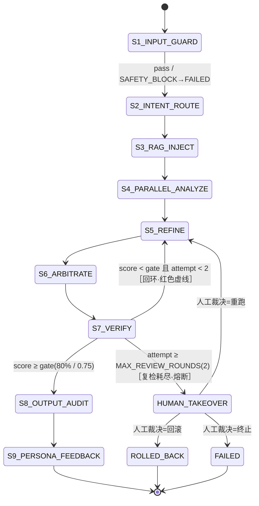
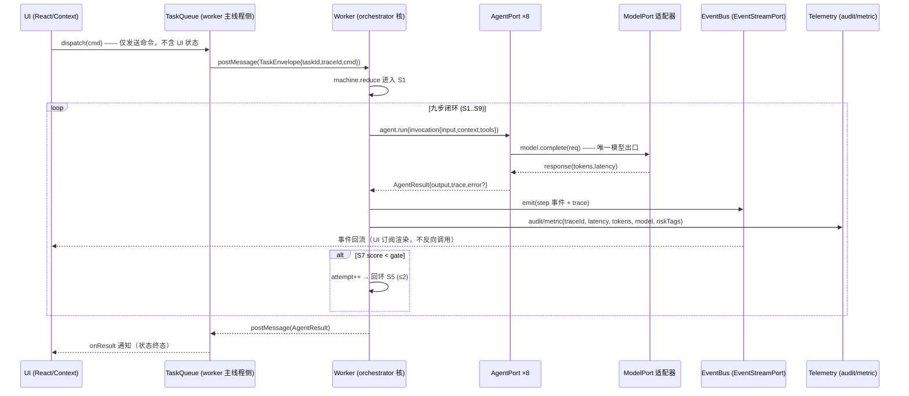

# 项目架构审核报告

## 0. 现状锚点 (what exists, cite files) — brief

1. Agent 端口接口定义
2. 九步状态机图
3. 任务队列与 Agent 交互时序
4. 需要抽离的模块与 PR 拆分
5. 禁止清单（DOM/localStorage/fetch）+ 强制手段（eslint + dependency-cruiser + 运行时）

Keep concise. Let me write.
已读完全链路现状。先给结论：项目里**已有端口架构雏形**（[ports.ts](file:///Users/yanyu/YYC-Cube/YYC3-MiniMax/src/types/ports.ts) 四个端口 + [ports.contract.test.ts](file:///Users/yanyu/YYC-Cube/YYC3-MiniMax/tests/contracts/ports.contract.test.ts) + [.dependency-cruiser.cjs](file:///Users/yanyu/YYC-Cube/YYC3-MiniMax/.dependency-cruiser.cjs) 分层守卫），但**没有 orchestrator 核、没有状态机、没有队列/worker**——Agent 回复目前是 UI 内的 setTimeout 假语义路由（[useWidgetChat.ts](file:///Users/yanyu/YYC-Cube/YYC3-MiniMax/src/hooks/useWidgetChat.ts#L110-L138)），九步是视图内的轮播动画（[P3ReActWorkflow.tsx](file:///Users/yanyu/YYC-Cube/YYC3-MiniMax/src/views/P3ReActWorkflow.tsx#L44-L114)）。以下方案是在现有分层上**增量抽核**，不推倒重来。

---

## 0. 现状锚点（对齐依据）

| 现状 | 位置 | 结论 |
| --- | --- | --- |
| 端口契约 | [types/ports.ts](file:///Users/yanyu/YYC-Cube/YYC3-MiniMax/src/types/ports.ts) | 复用，**追加** AgentPort / ModelPort / OrchestratorPort / TaskQueuePort |
| 分层守卫 | [.dependency-cruiser.cjs](file:///Users/yanyu/YYC-Cube/YYC3-MiniMax/.dependency-cruiser.cjs) | services-no-ui / core-no-framework 已存在，新增 orchestrator 规则 |
| 门禁阈值 | [domain/constants.ts](file:///Users/yanyu/YYC-Cube/YYC3-MiniMax/src/domain/constants.ts) | `MAX_REVIEW_ROUNDS: 2` 已是「复检≤2轮」的单一事实源 |
| 8 Agent 档案 | [data/agents.ts](file:///Users/yanyu/YYC-Cube/YYC3-MiniMax/src/data/agents.ts) | 仅展示元数据，需**拆分**出行为核 |
| ReAct 九步 | [data/reactSteps.ts](file:///Users/yanyu/YYC-Cube/YYC3-MiniMax/src/data/reactSteps.ts) | 静态数据，需**升格**为状态机定义 |
| 遥测 | [telemetry.ts](file:///Users/yanyu/YYC-Cube/YYC3-MiniMax/src/services/telemetry.ts#L104-L121) | `audit/metric` 已带 traceId，直接复用为 trace 汇点 |
| 事件回流 | [eventStream.ts](file:///Users/yanyu/YYC-Cube/YYC3-MiniMax/src/services/eventStream.ts) + [useAgentEventStream.ts](file:///Users/yanyu/YYC-Cube/YYC3-MiniMax/src/hooks/useAgentEventStream.ts) | 已是「UI 只订阅、服务只产事件」→ **worker 直接复用此端口** |

---

## 1. Agent 端口接口定义

统一六元组：`input · context · tools · output · trace · error`。全部落在纯核 `src/types/`，适配器落 `services/`。

```ts
// src/types/agent.ts —— 纯核契约，零依赖（不得 import react/next/services）

// ---------- 六元组 ----------
export interface AgentInput {
  taskId: string;                // 队列任务 ID（幂等键）
  traceId: string;               // 全链路追踪 ID（贯穿九步与遥测）
  step: ReActStepId;             // 当前步（1..9）
  attempt: number;               // 复检轮次（0 起，上限 GATES.MAX_REVIEW_ROUNDS）
  payload: Record<string, unknown>;  // 上一步产物（含检查点快照）
}

export interface AgentContext {
  agentId: AgentId;
  memory: Readonly<Record<string, unknown>>;   // RAG 注入 / 前序剧集记忆（只读）
  budget: { maxTokens: number; maxLatencyMs: number };
  riskPolicy: ReadonlyArray<RiskTag>;          // 本步需强制命中的风险标签
}

export interface ToolResult { ok: boolean; data?: unknown; error?: AgentError }
export interface AgentTool { readonly name: string; call(args: Record<string, unknown>): Promise<ToolResult> }
export interface ToolRegistry { get(name: string): AgentTool | undefined }

export interface AgentOutput {
  ok: boolean;
  payload: Record<string, unknown>;
  score?: number;                // 门禁分（Step7 一致性 / SyncNet 等）
  tokensIn: number;
  tokensOut: number;
}

export interface AgentTrace {
  traceId: string;
  taskId: string;
  agentId: AgentId;
  step: ReActStepId;
  attempt: number;
  model: string;                 // 模型名（如 flux-pro-cinema）
  provider: ProviderKind;        // 'local' | 'vllm' | 'registry' | 'mock'
  latencyMs: number;
  tokensIn: number;
  tokensOut: number;
  riskTags: RiskTag[];           // 命中/声明的风险：PII/越狱/涉政/版权/一致性…
  startedAt: string;             // ISO 8601
  endedAt: string;
}

export type AgentErrorCode =
  | 'MODEL_TIMEOUT' | 'TOOL_ERROR' | 'BUDGET_EXCEEDED'
  | 'GATE_FAIL' | 'SAFETY_BLOCK' | 'REVIEW_EXHAUSTED';

export interface AgentError {
  code: AgentErrorCode;
  message: string;
  retryable: boolean;
  rollbackTo?: ReActStepId;      // 回滚检查点目标步（Step7→Step5）
}

// ---------- 统一端口：8 Agent 全部实现此接口 ----------
export interface AgentInvocation {
  input: AgentInput;
  context: AgentContext;
  tools: ToolRegistry;           // 注入式，Agent 不直接持有实现
}
export interface AgentResult {
  output?: AgentOutput;
  trace: AgentTrace;             // 无论成败必带 trace（可观测铁律）
  error?: AgentError;
}
export interface AgentPort {
  readonly id: AgentId;
  readonly primaryStages: ReadonlyArray<PipelineStageId>;
  run(inv: AgentInvocation): Promise<AgentResult>;
}
```

**模型端口（适配器可替换：本地 / vLLM / Registry）：**

```ts
// src/types/ports.ts 追加
export type ProviderKind = 'local' | 'vllm' | 'registry' | 'mock';
export interface ModelRequest {
  traceId: string; model: string; system: string;
  messages: ReadonlyArray<{ role: 'user' | 'assistant'; content: string }>;
  maxTokens: number; temperature?: number;
}
export interface ModelResponse { text: string; tokensIn: number; tokensOut: number; latencyMs: number; model: string }
/** 所有 Agent 调用模型的唯一出口；换后端只换实现，签名冻结 */
export interface ModelPort { readonly provider: ProviderKind; complete(req: ModelRequest): Promise<ModelResponse> }

// 编排端口（UI 只认识这三个）
export interface OrchestratorPort {
  dispatch(cmd: AgentCommand): Promise<{ taskId: string; traceId: string }>;  // 只发命令
  cancel(taskId: string): void;
  resume(taskId: string, humanDecision: HumanDecision): Promise<void>;        // 人工接管后续跑
}
export interface TaskQueuePort {
  enqueue(task: TaskEnvelope): void;
  onResult(cb: (r: AgentResult) => void): () => void;
  size(): number;
}
```

**8 Agent → 步 → 模型 → 风险标签映射**（行为核，展示元数据仍留 [data/agents.ts](file:///Users/yanyu/YYC-Cube/YYC3-MiniMax/src/data/agents.ts)）：

| Agent | 主责步 | 模型 | 默认风险标签 |
| --- | --- | --- | --- |
| 言启·千行 | S2 意图路由 | deepseek-v4-pro | `intent-spoof` |
| 语枢·万物 | S4 分析并行 / S3 Schema | claude-3.7-sonnet | `schema-drift` |
| 预见·先知 | S4 预测 | nemotron-4-340b | `syncnet` `trend` |
| 知遇·伯乐 | S9 画像反哺 | deepseek-v4-recommender | `feedback-poison` |
| 元启·天枢 | S6 全局仲裁 | nemotron-super-120b | `budget` `consensus` |
| 智云·守护 | S1 入安 / S8 出审 | deepseek-v4-guard | `pii` `jailbreak` `涉政` |
| 格物·宗师 | S7 质量复检 | qwen-2.5-max-eval | `consistency` `gate` |
| 创想·灵韵 | S5 报告润色 | flux-pro-cinema | `copyright` |

---

## 2. 九步状态机图

状态机定义在 `src/core/orchestrator/machine/reactStateMachine.ts`（纯函数 reducer，零 UI）。门禁阈值取自 [GATES](file:///Users/yanyu/YYC-Cube/YYC3-MiniMax/src/domain/constants.ts#L17-L24)。



转移表（reducer 契约，可直接写测试）：

| 当前 | 事件 | 守卫 | 下一 | 副作用 |
| --- | --- | --- | --- | --- |
| S7_VERIFY | verify.done | `score ≥ gate` | S8 | 记 trace，attempt 归零 |
| S7_VERIFY | verify.done | `score < gate && attempt+1 < 2` | S5 | `attempt++`，emit `react.loopback`，**写检查点** |
| S7_VERIFY | verify.done | `attempt+1 ≥ 2` | HUMAN_TAKEOVER | emit `human.takeover.required`，挂起 |
| 任意步 | agent.error(retryable) | `retry < maxRetry` | 同一步 | 退避重试，emit `agent.retry` |
| 任意步 | agent.error(!retryable) | — | ROLLED_BACK/FAILED | 回滚至 `error.rollbackTo` 检查点 |

终态：`DONE`(S9后) · `FAILED` · `ROLLED_BACK` · `HUMAN_TAKEOVER`(可恢复)。

---

## 3. 任务队列与 Agent 交互时序

核心原则：**UI 只 `dispatch` 命令，worker 执行，事件经 EventBus 回流**。Web Worker 内跑 `core/orchestrator`（无 DOM，天然满足隔离）。



关键不变量：

- `traceId` 在 `dispatch` 时生成一次，贯穿九步与全部 audit/metric（[createTraceId](file:///Users/yanyu/YYC-Cube/YYC3-MiniMax/src/services/telemetry.ts#L40-L46)）。
- worker 与 UI 之间**只传结构化消息**（TaskEnvelope / 事件），不共享引用。
- 断连降级复用现有双模事件流（[eventStream.ts](file:///Users/yanyu/YYC-Cube/YYC3-MiniMax/src/services/eventStream.ts#L91-L205)）：LIVE(worker/网关) ↔ SIM(本地演示)。
- 重试/回滚/人工接管：worker 持检查点栈，`humanDecision` 经 `OrchestratorPort.resume` 回灌。

---

## 4. 需要抽离的模块与 PR 拆分

目标分层（在现有 `types/domain → data → services → context → components/views → app` 中**插入 core 与 workers**）：

```
types/domain (纯核)
  └─ core/agent-orchestrator   ← 新增：不依赖 UI/Next/react
        ├─ agents/            8 Agent 行为核（AgentPort 实现）
        ├─ machine/           九步状态机 reducer
        ├─ queue/             任务队列 + 检查点/重试/回滚
        └─ runtime/           编排循环（只依赖 ports）
  └─ services/adapters/       ← 新增：ModelPort 适配器 local/vllm/registry
  └─ workers/                 ← 新增：worker 入口，桥接 core ↔ UI
```

| PR | 范围 | 交付物 | 依赖 | 验证 |
| --- | --- | --- | --- | --- |
| **PR1** | `types/agent.ts` 六元组 + `ports.ts` 追加 ModelPort/OrchestratorPort/TaskQueuePort | 契约类型 + `tests/contracts/agent.contract.test.ts` 结构断言 | 无 | `typecheck && test` |
| **PR2** | 抽 `core/agents/*`：8 Agent 行为核（复用 [data/agents.ts](file:///Users/yanyu/YYC-Cube/YYC3-MiniMax/src/data/agents.ts) 元数据，行为独立） | 8 个 `AgentPort` 实现 + 单测 | PR1 | 每 Agent 返回必带 trace |
| **PR3** | `core/machine/reactStateMachine.ts` 九步 reducer（含 S7→S5 回环、≤2 轮、终态） | reducer + **穷举转移表测试** | PR1 | Step7 不达标→S5，第 3 次→HUMAN_TAKEOVER |
| **PR4** | `core/queue`：TaskEnvelope、检查点栈、重试退避、回滚；`workers/orchestrator.worker.ts` | 队列 + worker 边界 + 集成测试 | PR1,PR3 | dispatch→事件回流→终态 |
| **PR5** | `services/adapters/{local,vllm,registry,index}.ts` 实现 `ModelPort`；工厂按 `NEXT_PUBLIC_MODEL_PROVIDER` 选择 | 适配器 + `ModelPort` 契约测试（与 [ports.contract.test.ts](file:///Users/yanyu/YYC-Cube/YYC3-MiniMax/tests/contracts/ports.contract.test.ts) 同构） | PR1 | 换 provider 不改调用方 |
| **PR6** | UI 解耦：`context/agent.tsx` 注入 `OrchestratorPort`；[useWidgetChat.ts](file:///Users/yanyu/YYC-Cube/YYC3-MiniMax/src/hooks/useWidgetChat.ts) 删 setTimeout，改 dispatch + 订阅；P3 视图订阅状态机快照，[P3ReActWorkflow.tsx](file:///Users/yanyu/YYC-Cube/YYC3-MiniMax/src/views/P3ReActWorkflow.tsx) 的轮播改为「消费 trace 流」 | 视图/hook 改造 + 组件测试回归 | PR2-PR5 | 现有 130 测试不回归 |
| **PR7** | 可观测闭环：`trace`→audit/metric 落点、人工接管卡片（复用 [components/p5/GateCard.tsx](file:///Users/yanyu/YYC-Cube/YYC3-MiniMax/src/components/p5/GateCard.tsx) 风格）+ `OrchestratorPort.resume` 全链路测试 | trace 管道 + takeover UI + E2E | PR6 | traceId 串联九步可检索 |

**顺序即依赖**：PR1(契约) → PR2/PR3 并行 → PR4 → PR5 → PR6 → PR7。每个 PR 独立可合并、独立过门禁（`pnpm typecheck && lint && knip && test:coverage && build`）。

---

## 5. 禁止清单：Agent 不得直接操作 DOM / localStorage / fetch

**三处硬约束 + 三层强制**（约束靠纪律会破，必须靠工具链锁死）：

| 禁止项 | 原因 | 替代路径`（唯一合法出口）` |
| --- | --- | --- |
| `document` / `window` / DOM 事件 | core 须能在 Worker/Node 跑，UI 无关 | 状态经 `EventStreamPort` 回流，UI 订阅渲染 |
| `localStorage` / `sessionStorage` | 持久化是边界职责，core 必须可注入 | `StoragePort` 端口，适配器 [useLocalStorage](file:///Users/yanyu/YYC-Cube/YYC3-MiniMax/src/hooks/useLocalStorage.ts) 收口 |
| `fetch` / `XMLHttpRequest` / `WebSocket` | 网络调用须可替换（本地/vLLM/Registry） | 一律走 `ModelPort` / `PiiGatewayPort`（[piiReveal.ts](file:///Users/yanyu/YYC-Cube/YYC3-MiniMax/src/services/piiReveal.ts#L73-L111) 已是「fetch 只存在于受控服务」的范式） |

**强制手段（三层）：**

1. **依赖图（编译无关，运行 `pnpm depcruise`）** — [.dependency-cruiser.cjs](file:///Users/yanyu/YYC-Cube/YYC3-MiniMax/.dependency-cruiser.cjs) 追加：

```js
{
  name: 'core-no-framework',
  comment: 'orchestrator 核不得依赖 react/next/components/views/hooks/app',
  severity: 'error',
  from: { path: '^src/core/' },
  to: { path: '^src/(components|views|hooks|context|app)/' },
},
{
  name: 'core-no-framework-npm',
  severity: 'error',
  from: { path: '^src/core/' },
  to: { dependencyTypes: ['npm'], path: '^(react|react-dom|next)(/|$)' },
},
```

1. **Lint（`pnpm lint`）** — [eslint.config.js](file:///Users/yanyu/YYC-Cube/YYC3-MiniMax/eslint.config.js) 追加 scoped 规则，仅对 `src/core/**` 与 `src/types/**`：

```js
{
  files: ['src/core/**/*.{ts,tsx}', 'src/types/**/*.ts'],
  rules: {
    'no-restricted-globals': ['error',
      { name: 'window', message: 'core 禁止 DOM：状态经 EventStreamPort 回流' },
      { name: 'document', message: 'core 禁止 DOM' },
      { name: 'localStorage', message: 'core 禁止持久化：改走 StoragePort' },
      { name: 'fetch', message: 'core 禁止网络：改走 ModelPort/PiiGatewayPort' }],
    'no-restricted-syntax': ['error',
      { selector: "NewExpression[callee.name='WebSocket']", message: 'core 禁止直连网络' },
      { selector: "NewExpression[callee.name='XMLHttpRequest']", message: 'core 禁止直连网络' }],
  },
},
```

1. **契约测试（`pnpm test`）** — `tests/contracts/agent.contract.test.ts`：断言每个 `AgentPort` 实现（a）返回必带 `trace.traceId`；（b）在 stub 掉 `globalThis.fetch/window` 后仍能通过 `MockModelPort` 正常跑完——**运行时证明 core 不触碰被禁全局**。

> 一句话收口：**端口是唯一的墙，适配器是唯一的门。** UI 只 `dispatch` + 订阅事件；core 只认 `AgentPort`/`ModelPort`；DOM/存储/网络的真实实现全部沉在 `services/adapters/*`——谁要换本地模型/vLLM/Registry，只换一个适配器，签名冻结，核不动。

---

建议从 **PR1（纯契约，零行为变更）** 开始，可一次性产出 `types/agent.ts` + 契约测试并保持全门禁绿。另外按你们 `docs/{项目}-{导师}-{YYYYMMDD}/` 存档规范，这份五段式设计可持续归档为 `00-架构解耦设计.md`
